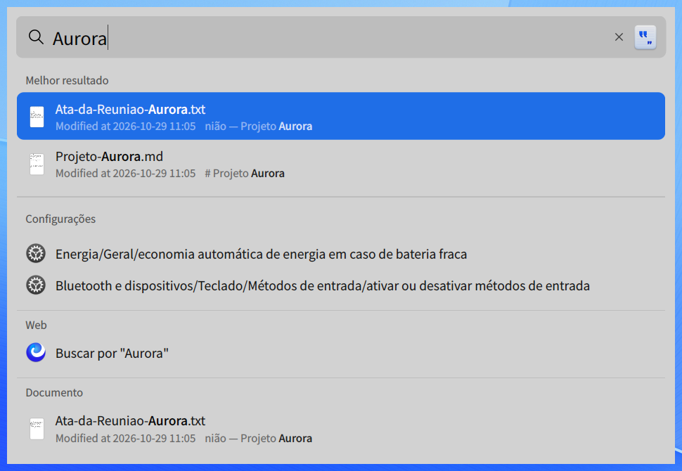
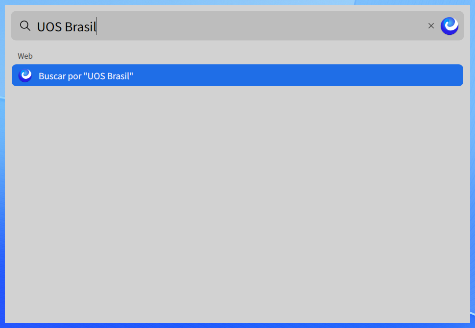
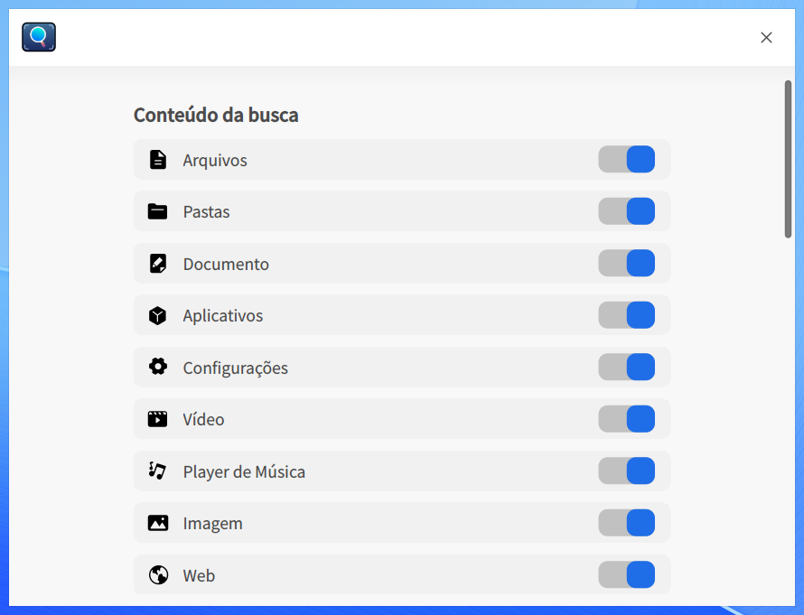
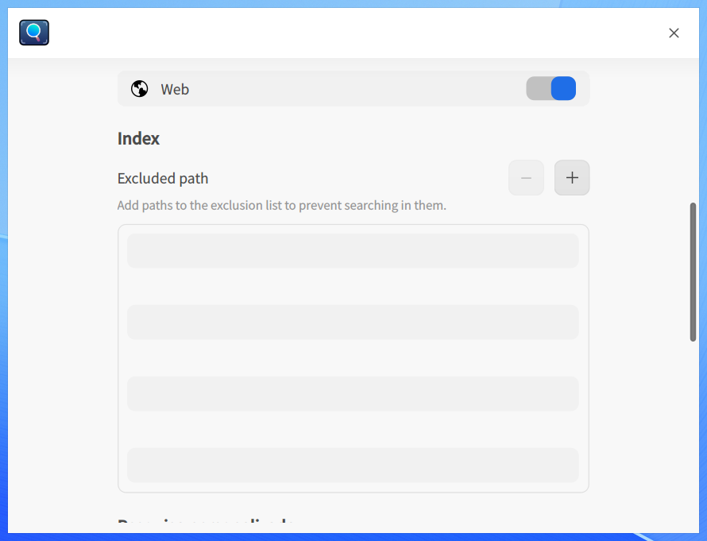

# Pesquisa geral|dde-grand-search|

## Visão geral

A Pesquisa geral é uma ferramenta do sistema para localizar conteúdo rapidamente. Você pode abri-la pelo ícone na barra de tarefas ou por um atalho de teclado. Digite palavras-chave para pesquisar, em tempo real, aplicativos, arquivos, configurações, vídeos, músicas e outros conteúdos. Os resultados são organizados por categoria e podem ser visualizados rapidamente, o que facilita a localização dos recursos do sistema.

## Abrir e fechar

### Abrir

* Clique em  na barra de tarefas ou pressione **Shift + Space** para abrir a caixa de pesquisa.

### Fechar

* Clique em qualquer área fora da caixa de pesquisa ou pressione **Esc** para fechá-la.

## Pesquisar arquivos

### Pesquisa comum

* Digite na caixa de pesquisa uma palavra-chave do nome do arquivo ou do conteúdo de um documento compatível. Os resultados aparecem enquanto você digita.
* Os resultados são organizados em grupos de acordo com as categorias ativadas nas configurações.
* Quando **Melhor resultado** está ativado, o item considerado mais relevante aparece no início da lista.

### Pesquisa na Web

No grupo **Web**, clique em **Buscar por “palavra-chave”** para pesquisar no navegador usando o motor de pesquisa padrão. A abertura da página depende da conexão de rede e do navegador disponível.

### Abrir resultados

* Use as teclas de seta para cima e para baixo para selecionar um resultado.
* Clique em um arquivo ou pressione **Enter** para abri-lo no aplicativo associado.

## Configurações de Busca

Clique com o botão direito em  na barra de tarefas e selecione **Configurações de Busca**.

### Conteúdo da busca

* Ative ou desative as categorias que podem aparecer nos resultados: **Arquivos**, **Pastas**, **Documento**, **Aplicativos**, **Configurações**, **Vídeo**, **Player de Música**, **Imagem** e **Web**.
* Quando uma categoria é desativada, o grupo correspondente deixa de aparecer nos resultados. Ative-a novamente para restaurar o grupo.

### Index

Na seção **Index**, use os botões  e  de **Excluded path** para adicionar ou remover pastas da lista de exclusão. Os arquivos armazenados nas pastas excluídas não aparecem nos resultados.

### Pesquisa personalizada

**Configurações de alfaiate**

* Marque **Diretório Parental** para mostrar o caminho da pasta superior ao final de cada resultado e facilitar a distinção entre arquivos com nomes iguais.

**Melhor resultado**

* Ative **Melhor resultado** para exibir o grupo com o item mais relevante no início da lista.

**Motor de pesquisa padrão**

* Escolha o motor usado pelo grupo **Web** para pesquisar palavras-chave no navegador.

**Programa de experiência com a busca**

* Antes de ativar **Participe do programa de experiência com a busca**, leia as informações de privacidade exibidas na própria janela para entender quais dados poderão ser coletados.
